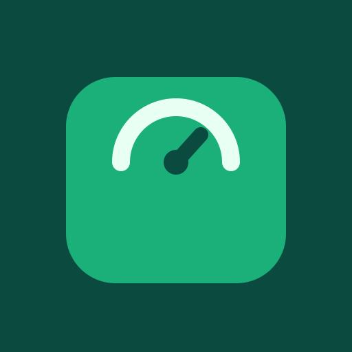

# Lager apps

Small, self-contained web apps for [Lager](https://github.com/dm807cam/lager), the self-hosted server for personal web apps. Every app is one HTML file plus a manifest, so it can be deployed to any Lager server as it is.

<!-- catalog:start -->
| | App | What it does | Language | Category |
|---|---|---|---|---|
|  | [Byline](apps/byline) | Cookie-free blog analytics: readers, read time, read-through, sources, trending posts and the best time to publish. | English | analytics · beta |
|  | [Deutsch-Dino](apps/deutsch-dino) | Endloses Deutsch-Spiel für die Klassen 1 bis 4: Aufgaben lösen, Dino-Eier knacken und alle Dinos für den Dino-Park sammeln. | Deutsch | education |
|  | [Folio](apps/folio) | An ebook reader for EPUB and text: pages or scroll, themes and fonts, highlights and notes, synced progress, reading stats and Habits. | English | reading · beta |
|  | [Gesichtsschutz](apps/gesichtsschutz) | Erkennt Gesichter in deinen Fotos und macht sie direkt im Browser unkenntlich – irreversibel und ohne Upload. | Deutsch | privacy |
|  | [Ghostberry](apps/ghostberry) | A Ghost-style blog: write with cards, publish or schedule, tags, authors, members, Ghost themes. Almanac is the default theme. | English | publishing · beta |
|  | [Habits](apps/habit-tracker) | Daily and weekly habits with streaks and a yearly heatmap. Your workout, meditation and reading apps tick linked habits by themselves. | English | health · beta |
|  | [Kommentare](apps/kommentare) | Einbettbares Kommentarsystem mit verschachtelten Antworten, Daumen hoch/runter, Moderation und Site-Auswahl für mehrere Websites. | Deutsch | publishing |
|  | [Leanline](apps/leanline) | Log weight and body fat as often as you like and see your trend against your ideal BMI and body-fat zones. | English | health |
|  | [Mathe-Monster](apps/mathe-monster) | Endloses Mathe-Spiel für die Klassen 1 bis 4: Aufgaben lösen, Monster besiegen, Münzen sammeln und Helden freischalten. | Deutsch | education |
|  | [Portfolio Pulse](apps/portfolio-pulse) | Log your portfolio value and see it plotted over time against 1–10% yearly growth lines. | English | finance |
|  | [Satz](apps/satz) | Fokussiertes Schreiben für ganze Bücher – mit Kapiteln, Fokusmodus und einer sortierbaren Ablage für Gedankenfetzen. | Deutsch | writing |
|  | [Sealed](apps/sealed) | End-to-end encrypted messenger: private chats, groups and photos with signed messages, safety numbers and disappearing messages. | English | social · beta |
|  | [Stillwater](apps/stillwater) | A calm meditation timer with breathing guide, synthesised bells and ambience, a journal, and stats with streaks and a yearly heatmap. | English | health |
|  | [Wissensfunke](apps/wissensfunke) | Jeden Tag ein überraschender Funfact aus der Wissenschaft – mit Archiv und Merkliste. | Deutsch | education |
|  | [Workout Tracker](apps/workout-tracker) | Workout tracker: plans, custom exercises, workouts from a plan or on the go, records, charts, a yearly heatmap and an AI coach. | English | health |
<!-- catalog:end -->

## Layout

```
apps/<slug>/
  index.html      the whole app: markup, styles and script in one file
  lager.json      manifest: title, description, version, capabilities, icon, seed data, external hosts
  icon.svg        app icon (the SVG subset Lager accepts)
  README.md       what the app does, its data and how to install it
  seed/*.json     optional starter data as [{path, data}], never anyone's personal data
  tests/*.spec.mjs  optional app tests (Playwright)
tools/            validator, catalog builder, the mock Lager runtime used by the tests
tests/            smoke tests that run for every app automatically
docs/             the app standard, testing standard, privacy rules and shared APIs
catalog.json      machine-readable index of all apps, generated from the manifests
```

## Install an app on your Lager server

1. Deploy `apps/<slug>/index.html` with `deploy_app` (or `PUT /api/apps/<slug>`), passing `title`, `description`, `theme_color`, `icon_svg` and `capabilities` from `lager.json`. In capabilities, replace `${LAGER_APPS_DOMAIN}` with your server's apps domain.
2. If the manifest lists `seed` files, import them with `import_data` (or `POST /api/instances/<slug>/import`).
3. Open the URL Lager returns.

## Working on the apps

```sh
npm install
npx playwright install chromium   # or set CHROME_PATH to an installed Chrome
npm run check                     # validate + catalog check + all tests
npm run validate -- habit-tracker # one app
npx playwright test apps/habit-tracker
```

Read these before adding or changing an app:

- [App standard](docs/APP_STANDARD.md): folder layout, manifest fields, code rules
- [Testing standard](docs/TESTING.md): what is tested automatically and what each app adds
- [Privacy rules](docs/PRIVACY.md): what must never be committed, and how the scan enforces it
- [Activity API v1](docs/ACTIVITY_API.md): how apps tell the Habit Tracker about finished activities

Every push and pull request runs the same checks in GitHub Actions (`.github/workflows/ci.yml`).
