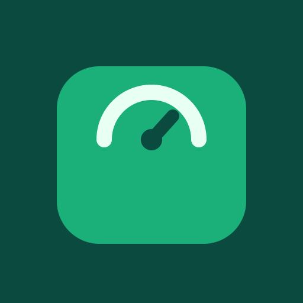

#  Leanline

Log weight and body fat as often as you like and see your trend against your ideal BMI and body-fat zones.

**Language:** English · **Category:** health · **Status:** stable · **Deployed version:** 4

## Notes

Entries are shared by everyone the instance is shared with; keep it private unless that is intended.

## Capabilities

| Capability | Used for |
|---|---|
| `db` | stores the app's data in the instance |

## Install

1. Deploy `index.html` as the app `leanline` with the `title`, `description`, `themeColor` (as `theme_color`), `icon.svg` (as `icon_svg`) and `capabilities` from [`lager.json`](lager.json).

## Tests

The [smoke tests](../../tests/smoke.spec.mjs) run for this app automatically.
